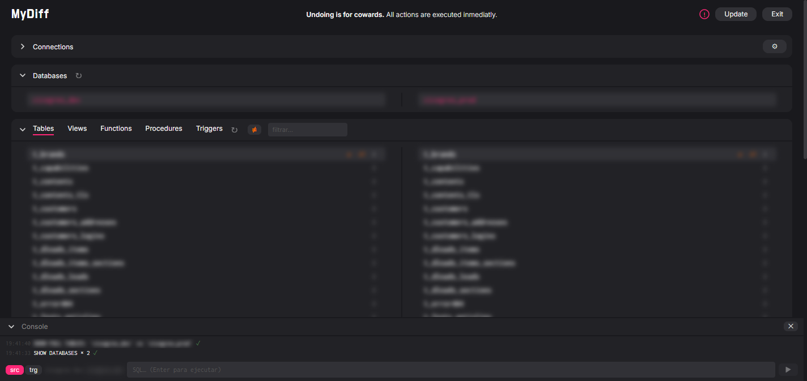

# MyDiff

A small self-hosted web app to compare two MySQL servers side by side and fix
the differences on the spot.



> **Undoing is for cowards.** Every action runs immediately against the real
> databases. There is no undo, no dry run and no confirmation for most actions.
> Use it with care, and keep backups.

## What it compares

Pick a **source** (`src`) connection on the left and a **target** (`trg`)
connection on the right, then drill down:

- **Databases** - which databases exist on each side.
- **Tables and views** - which exist on each side, and which have a different
  structure.
- **Routines** - triggers, functions and procedures, with a side-by-side diff
  of their definitions.
- **Structure** - column by column (type, nullability, default, extra), with
  generated `ALTER TABLE` statements you can review, edit and run on either side.
- **Data** - row by row, matched by primary key, highlighting the cells that
  differ.

Databases and tables can be selected independently on each side, so you can
compare `shop_dev.orders` with `shop_prod.orders`, or two different tables.

## What it can fix

- Create a table, view or routine that only exists on one side.
- Align columns between two tables (`ADD COLUMN` / `MODIFY COLUMN`).
- Replace a view or routine definition with the other side's.
- Transfer data from one table to the other, with an optional `WHERE`, in
  three modes: truncate and insert, insert ignoring duplicates, or upsert.
  It works between different servers too.
- Run any SQL from the built-in console, on either connection. The interface
  refreshes afterwards.

## Requirements

- A web server with **PHP 8** and the `pdo_mysql` extension.
- The `zip` extension and outgoing HTTPS access, only for the **Update** button.
- Write permission for the web server user on the application folder (to store
  connections, the password and updates).
- A modern browser. There is no build step: the front end is plain ES modules
  with [Preact](https://preactjs.com/) bundled in `preact.js`.

## Installation

Clone or copy the repository into a folder served by your web server:

```bash
git clone https://github.com/AlbinSoft/mydiff.git
```

Open it in the browser. **The first password you enter becomes the master
password** (8 characters minimum), so do this right after installing.

Then open the connections manager (the gear button in the *Connections* panel)
and add your MySQL servers.

## Updating

Any of these works:

- The **Update** button in the header: it downloads the latest `main` from
  GitHub, copies it over the installation and reloads the page.
- `./update.sh` (Linux/macOS) or `update.bat` (Windows) from the application
  folder.
- `git pull`, if you installed it with `git clone`.

Local data files (`connections.data.php`, `auth_config.php`) are not part of
the repository and are never overwritten.

## Security

MyDiff gives full access to every database its connections can reach, so treat
it as an admin tool:

- Do not expose it publicly. Put it behind a VPN, an IP allowlist or HTTP
  authentication, and always use HTTPS.
- Access requires the master password. After several failed attempts, login is
  locked for 30 seconds.
- Connections, credentials included, are stored in `connections.data.php`. The
  password hash is stored in `auth_config.php`. Both are PHP files, so
  requesting them by URL returns nothing.
- The included `.htaccess` (Apache) disables directory listing and blocks
  `.json`, `.md` and `.log` files. On other web servers, set up the same rules.
- SQL travels base64-encoded between the browser and `api.php`, so web
  application firewalls do not block it. This is not encryption.

## Files

| File          | Purpose                                         |
|---------------|-------------------------------------------------|
| `index.html`  | Page shell                                      |
| `app.js`      | The whole single-page app                       |
| `style.css`   | Styles (dark theme)                             |
| `api.php`     | JSON back end: auth, connections, comparisons   |
| `preact.js`   | Preact + signals + HTM, standalone bundle       |
| `update.sh`, `update.bat` | Update scripts                      |

## Keyboard shortcuts

`Alt+1` to `Alt+4` fold and unfold the Connections, Databases, Tables and Data
panels.
